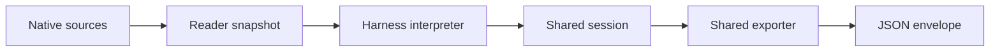

# JSON extraction architecture

Claude, Codex, and Copilot use the same pipeline to turn recorded native evidence
into portable JSON. Presentation belongs to the consuming application.

## Responsibility boundaries

The CLI selects sessions, owns connections, reports diagnostics, and writes output.
Readers snapshot the required records, sidecars, and image assets. Interpreters
consume those snapshots without source I/O and return an uncapped shared session.
All three adapters implement the [public stage contract](../src/session_log_extractors/extractor_contract.py).

Each harness interpreter establishes meaning and ownership near the native
evidence. It associates tools, results, questions, answers, and decisions through
recorded identities, containment, or explicit relationships. Matching counts,
text similarity, a recent human message, and timestamp proximity cannot establish
ownership. Missing or ambiguous evidence remains explicitly unresolved.

The shared model represents the ordered conversation and its attached facts.
Session collections support internal lookup and retain unassociated information;
they do not automatically become parallel top-level JSON lists. Consumers can
follow the exported conversation without rebuilding it from internal indexes.
Recorded values remain distinct from derived conclusions: successful execution
alone, for example, does not prove a file modification.

The exporter preserves established attachments and applies output policy. It
selects fields required by the JSON contract, copies content without mutating the
session, and caps textual tool results. It does not discover ownership, infer
new decisions, or project internal indexes onto the conversation. Internal facts
without an exported conversation owner may remain internal; each harness's
[provenance guide](../scripts/fixtures/README.md#native-evidence-and-limits)
documents that boundary.

## Preservation and uncertainty

Keep original message text, wrappers, whitespace, complete inputs, native
structured results, images, and meaningful order. Authorship is independent of
rendered role. Candidate words and deliberate control actions remain distinct
from automatically supplied context and other agents' contributions. Partial
evidence supports partial attribution; unknown does not mean candidate.

Questions, answers, refusal sources, plan content/decisions, file actions, task
prompts, and invocation facts are established before textual caps apply. Keep
feedback distinct from harness explanations, recommendations distinct from
selections, and cancellation distinct from rejection. Missing decisions never
imply approval. Unmatched records remain explicit rather than borrowing owners.
Unknown tool payloads are preserved and diagnosed; schema recognition is not
general runtime validation.

The exporter defaults to an **8,192-byte** textual-result limit. Zero clips
nonempty text; negative limits retain all text. It preserves original byte counts,
truncation provenance, and valid UTF-8. Structured attachments, nested native
objects/lists, inputs, message text, and images remain complete. A warning above
**8 MiB** includes all serialized content; the result cap is not a whole-file
size guarantee. File and stdout output use the same deterministic UTF-8 JSON
serialization. Diagnostics remain separate on stderr.

## Verification and limits

[Native-fixture contract tests](../scripts/test_extractor_contract.py) cover all
three adapters, source-free uncapped interpretation, and non-mutating export.
Harness tests check meaning and ownership; shared export tests check preservation
and output policy. Import Linter enforces dependency directions, while code
review assesses semantic responsibility and modeling choices.

These checks do not establish general runtime semantic validation. Approved
whole-output baselines and an automated fresh-capture drift workflow are
unfinished. Ordinary tests use committed captures and controlled boundaries,
without paid CLI calls. Generated wording is variable: regeneration should not
require rewriting prose expectations or approving a new prose baseline.

See the [preservation guide](../scripts/fixtures/README.md) for observable
acceptance examples, the [model](../src/session_log_extractors/session_model.py)
and [exporter](../src/session_log_extractors/session_log_envelope.py) for exact
fields, and the [historical plan](implementation-plan.md) for migration rationale.
